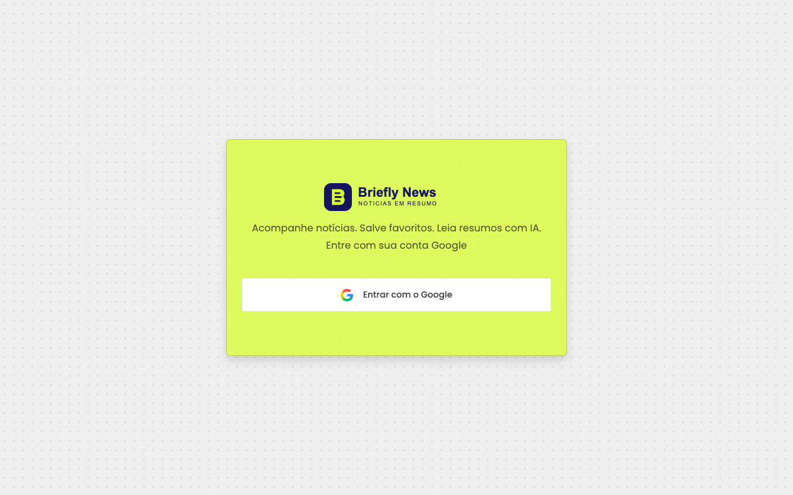
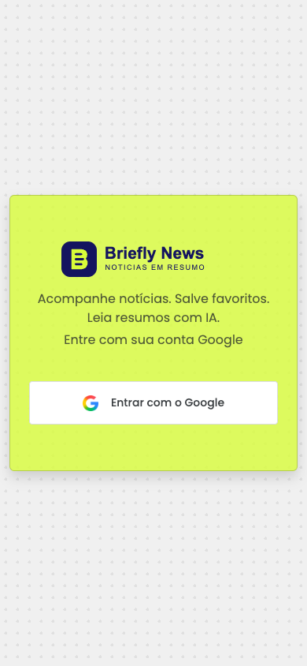

# Briefly News

**Follow the news. Save your favorites. Read AI-powered summaries.**

Briefly News is a full-stack application for reading news, saving personal favorites, and generating summaries with locally hosted AI. It combines React and NestJS with Ollama, without relying on a commercial LLM API to generate summaries.

Originally built for a technical challenge, the project is being adapted and developed further as part of my portfolio.

**Application language:** the user interface is currently in Brazilian Portuguese. This README is in English to make the project accessible to an international audience.

## Interface

### Desktop



### Mobile



These screenshots show the actual login screen. The news feed, favorites, and summaries require authentication and configured services. There is no publicly hosted demo yet.

## Features

- Google OAuth login and JWT-based API authentication.
- News feed integrated with NewsAPI, with filters in the interface.
- User-specific favorites.
- News summaries generated with Gemma 2:2b through Ollama.
- MySQL persistence for users, news articles, favorites, and summaries.
- Responsive interface with a modal for reading summaries.

## Tech stack

| Layer | Technologies |
|---|---|
| Frontend | React, TypeScript, Vite, Axios, Bootstrap |
| Backend | NestJS, TypeScript, Passport, JWT, TypeORM, class-validator |
| Database | MySQL |
| Local AI | Ollama and Gemma 2:2b |
| Environment | Docker and Docker Compose |

## Architecture

The frontend consumes the NestJS API. The backend fetches articles from NewsAPI, persists data in MySQL, and requests summaries from Ollama.

```text
React / Vite
     |
     v
NestJS API ---- NewsAPI
     |
     +-------- MySQL
     |
     +-------- Ollama / Gemma 2:2b
```

The backend is organized into authentication, users, news, favorites, and summaries modules. On the frontend, dedicated hooks separate authentication and data-access logic from UI components.

## Running locally

### Prerequisites

- Docker with Docker Compose.
- Google OAuth application credentials.
- A [NewsAPI](https://newsapi.org/) key.
- Internet access to fetch news and download the model on the first run.
- Available memory and disk space for MySQL and the local AI model; summary generation speed depends on your hardware.

### 1. Clone the repository and configure the environment

```bash
git clone https://github.com/yasminaltino/briefly-news.git
cd briefly-news
cp .env.example .env
```

Place `.env` **at the repository root**, alongside `docker-compose.yml`. Replace the placeholder values before starting:

| Variable | Purpose |
|---|---|
| `DB_HOST`, `DB_PORT` | MySQL address; use `db` and `3306` with Compose |
| `DB_USER`, `DB_PASSWORD`, `DB_NAME` | Application database username, password, and database name |
| `DB_ROOT_PASSWORD` | MySQL administrator password, different from the application password |
| `JWT_SECRET` | Random secret used to sign tokens |
| `JWT_EXPIRE_IN` | Token lifetime, for example `24h` |
| `GOOGLE_CLIENT_ID`, `GOOGLE_SECRET` | Google OAuth credentials |
| `GOOGLE_CALLBACK_URL` | Use `http://localhost:3000/auth/google/callback` locally |
| `NEWS_API_KEY` | NewsAPI key |
| `OLLAMA_URL` | Use `http://ollama:11434` with Compose |
| `PORT` | API port; use `3000` with the current configuration |

Generate `JWT_SECRET` with:

```bash
openssl rand -hex 32
```

Do not commit `.env` or use the placeholder values as real credentials.

### 2. Configure Google OAuth

In the [Google Cloud Console](https://console.cloud.google.com/), configure the consent screen and create an OAuth client of type **Web application**.

- Authorized redirect URI: `http://localhost:3000/auth/google/callback`.
- Authorized JavaScript origin, if requested: `http://localhost:5173`.
- If the application is in testing mode, add the account you will use to sign in as a test user.
- Copy the Client ID to `GOOGLE_CLIENT_ID` and the Client Secret to `GOOGLE_SECRET`.

The variable name used by the code is `GOOGLE_SECRET`, not `GOOGLE_CLIENT_SECRET`.

### 3. Start the services

```bash
docker compose up --build
```

| Service | Address |
|---|---|
| Frontend | http://localhost:5173 |
| API | http://localhost:3000 |
| Ollama | http://localhost:11434 |

The Ollama container downloads the `gemma2:2b` model on startup. Wait for the download to finish before requesting a summary; Compose startup ordering does not guarantee that the model or database is ready.

Database and Ollama data are stored in Docker volumes. Changing credentials in `.env` does not automatically reconfigure an already initialized database.

To stop the services without deleting their data:

```bash
docker compose down
```

## User flow

1. Sign in with your Google account.
2. Browse the news feed and its filters.
3. Save articles to your favorites.
4. Request a summary and read it in the modal.

Currently, the backend delivers the JWT through a redirect, and the frontend stores it in `localStorage`. This is a known limitation, not a recommended authentication pattern for production.

## Project structure

```text
briefly-news/
  backend/
    src/modules/
      auth/
      favorites/
      news/
      summaries/
      users/
    ollama/
    test/
  frontend/
    public/
    src/
      assets/
      components/
      hooks/
      pages/
      services/
      styles/
      types/
  docs/images/
  .env.example
  docker-compose.yml
```

## Design decisions and limitations

- **Local AI:** summary generation runs in a separate Ollama service, but response time depends on the host machine's resources.
- **Modular organization:** backend modules and frontend hooks define clear responsibilities.
- **Validation:** the API uses DTOs and `ValidationPipe` with whitelisting.
- **Development environment:** the current Compose setup runs development servers; it is not production-ready.
- **Authentication:** JWTs are passed in the query string and stored in `localStorage`, without refresh tokens.
- **Feed:** pagination and caching have not been implemented yet.
- **Integrations:** news access depends on NewsAPI availability and plan terms.
- **Quality:** automated coverage still needs to be developed; the existing E2E test is the initial NestJS example.

## Roadmap

- Authentication with httpOnly cookies and session renewal.
- Pagination, caching, and improved loading and error states.
- Unit tests, E2E tests for real user flows, and continuous integration.
- A demo mode with sample news.
- Environment-specific configuration for a hosted demo.
- Improvements to summary processing, logging, and rate limiting.
